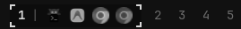

# App Workspaces

An Omarchy status bar plugin that displays workspace indicators and persistent monochrome application icons, with a fluid sliding HUD corner-bracket reticle that animates when switching workspaces.



## Features

- **Fluid Sliding Focus Reticle**: When switching workspaces, the corner-bracket frame (`┌ ┐ └ ┘`) and background pill smoothly glide across the bar to the newly active workspace with an `OutCubic` motion curve.
- **Dynamic Width Morphing**: The active indicator smoothly morphs its width as it glides between compact empty workspaces and expanded workspaces with multiple app icons.
- **Persistent Monochrome App Icons**: Every workspace that has open windows displays its running apps at all times across your desktop, colorized to match your Omarchy bar theme foreground color (`root.bar.barForeground`).
- **Active Window Emphasis**:
  - The currently focused window is rendered at full brightness (`1.0` opacity).
  - Background windows sit at a clean, dimmed opacity (`0.75` on the active workspace, `0.55` on other workspaces), brightening on hover.
  - Smooth color and opacity transitions when switching between active and inactive states.
- **Direct Window Focus**:
  - Click any app icon to immediately jump to that workspace and focus that specific window in Hyprland.
  - Hover over any app icon to see its live window title in the tooltip.
- **Workspace Navigation**:
  - Click any workspace number to switch directly to that workspace.
  - Scroll with mouse wheel anywhere over the widget to cycle workspaces (`m+1` / `m-1`).

## Structure

```
~/.config/omarchy/plugins/app-workspaces/
├── manifest.json       # Plugin manifest and bar widget metadata
├── BarWidget.qml       # Main bar widget implementation
├── LICENSE             # MIT License
├── assets/
│   └── preview.png     # Widget preview screenshot
└── README.md           # Plugin documentation
```

## Management

```bash
# Disable plugin
omarchy plugin disable mohiitp.app-workspaces

# Re-enable on the left bar section
omarchy plugin enable mohiitp.app-workspaces --section left

# Revert to default workspaces widget if ever needed
omarchy plugin enable omarchy.workspaces --section left
```

## License

This project is licensed under the [MIT License](LICENSE).
